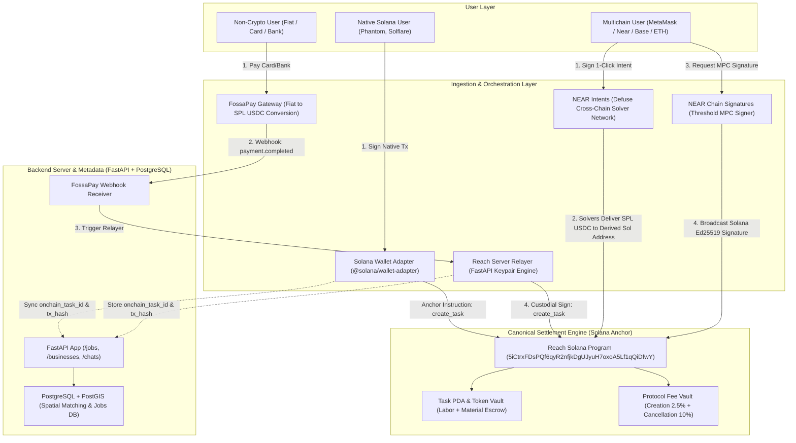
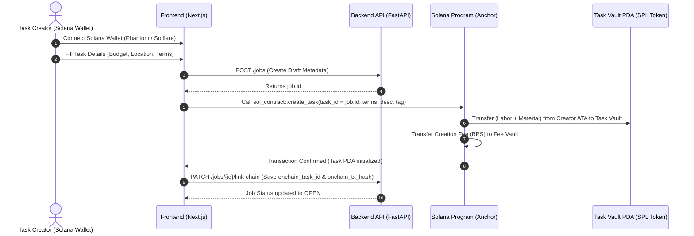
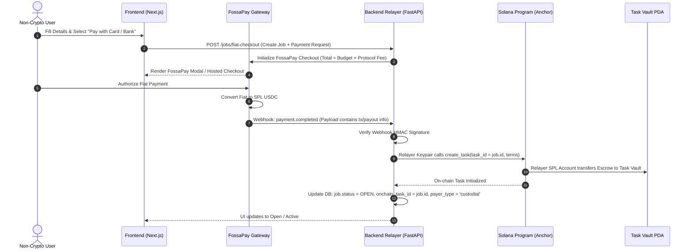
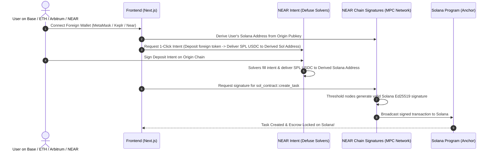
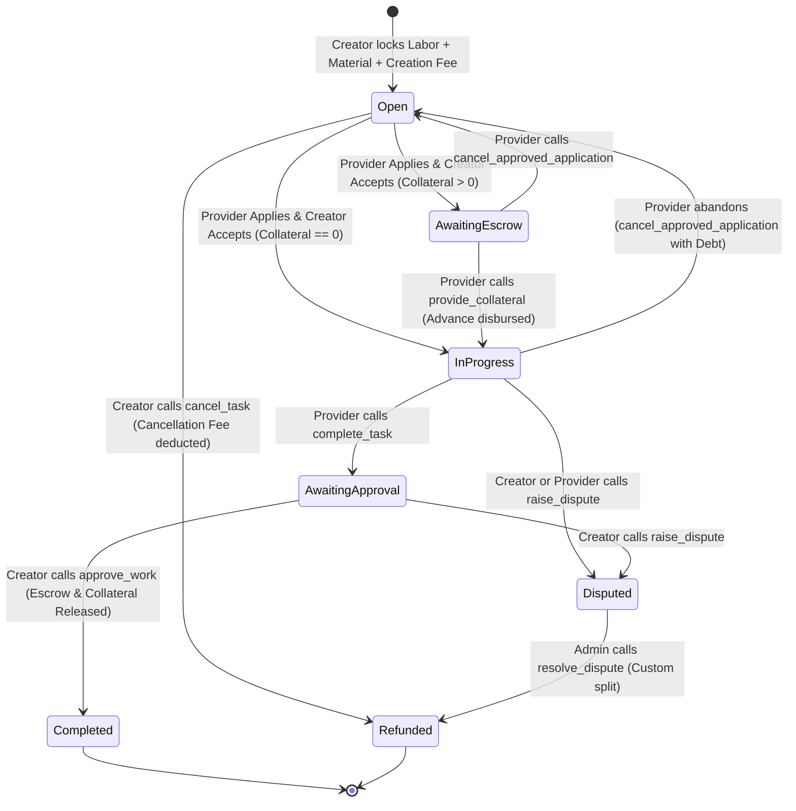

# Reach Protocol: Architecture & Flows Documentation (Model 1 Canonical)

This document defines the formal system architecture and operational flows for **Reach Protocol**, incorporating the decision to adopt **Model 1**:
* **Canonical Settlement Layer:** **Solana** ([`sol-contract/programs/sol-contract`](file:///home/peni/Projects/reach/sol-contract/programs/sol-contract)) executes all task creation, escrow locking, provider collateral deposits, upfront advance releases, and final settlements.
* **Multichain Routing & Execution:** **NEAR Intents** and **NEAR Chain Signatures (MPC)** enable users on any foreign blockchain (Base, Ethereum, Arbitrum, NEAR, Polygon) to convert assets into Solana SPL stablecoins and sign Solana Anchor transactions seamlessly.
* **Non-Crypto Gateway:** **FossaPay** collects fiat payments, auto-converts to stablecoins, and triggers the server relayer to call the Solana contract on the user's behalf.
* **Deprecated:** The standalone NEAR escrow contract ([`near-contract/`](file:///home/peni/Projects/reach/near-contract)) is deprecated to eliminate liquidity fragmentation.

---

## 1. High-Level System Architecture (Model 1)

---

## 2. Detailed Transaction Flows

### Flow 1: Native Solana Crypto User

1. **Wallet Connection:** The user connects Phantom, Solflare, or Backpack via `@solana/wallet-adapter-react`.
2. **Metadata Draft:** The frontend posts the job metadata (title, description, spatial coordinates, category) to `POST /jobs`.
3. **Contract Call Construction:** The client constructs an Anchor transaction calling `sol_contract::create_task`:
   - `task_id`: `job.id` from PostgreSQL (guarantees 1:1 ID parity).
   - `terms`: Labor fee, material cost, upfront advance percentage, required provider collateral.
   - `stable_coin_mint`: Whitelisted stablecoin (e.g. USDC).
4. **Escrow Lock:** The program debits `labor_fee + material_cost` into the `task_vault` PDA, and debits `creation_fee_pct` into the protocol `fee_vault`.
5. **State Synchronization:** The frontend submits the transaction signature to the backend (`PATCH /jobs/{id}/link-chain`), activating the job and triggering push notifications to nearby providers.

---

### Flow 2: Non-Crypto User (FossaPay + Server Relayer)

1. **User Experience:** The non-crypto user pays with local fiat (debit card, bank transfer, mobile money).
2. **FossaPay Ingestion:** FossaPay processes the fiat deposit and auto-converts to SPL USDC.
3. **Webhook Verification:** FossaPay dispatches an encrypted webhook (`payment.completed`) to `POST /api/webhooks/fossapay`.
4. **Relayer Execution:** The backend relayer holds an automated Solana keypair. Upon verifying the payment receipt, the relayer submits `create_task` to the Solana program on behalf of the user.
5. **Custodial Authority:** The server records `payer_type = "custodial"`. When the user later clicks "Approve Work" in the UI, the backend authorizes and signs the corresponding Solana transaction (`approve_work`).

---

### Flow 3: Multichain User (NEAR Intents + Chain Signatures to Solana)

1. **Deterministic Address Derivation:** The user's foreign address deterministically derives a valid Solana public key via NEAR's MPC threshold network (`v1.signer`).
2. **Cross-Chain Swap (NEAR Intents):** The user signs an off-chain intent on their origin chain. Market solvers deliver SPL USDC directly to their derived Solana address.
3. **Execution (Chain Signatures):** The user requests an MPC signature to execute `create_task` on Solana. The NEAR MPC network produces the Ed25519 signature and broadcasts it to Solana without the user ever managing private keys or installing Phantom.

---

### Flow 4: Task Lifecycle, Work Verification & Settlement

1. **Application:** Provider calls `apply(task_id, expires_at)`.
2. **Acceptance:** Creator calls `accept(task_id, provider)`.
   * If `required_provider_collateral > 0`: Status becomes `AwaitingEscrow`.
   * If `required_provider_collateral == 0`: Status becomes `InProgress`.
3. **Collateral & Advance Disbursement:**
   * Provider calls `provide_collateral(task_id)`.
   * If `upfront_release_pct > 0`, that percentage of `material_cost` is immediately paid out to the provider.
4. **Completion:** Provider finishes work and calls `complete_task(task_id)`. Status becomes `AwaitingApproval`.
5. **Settlement & Payout:** Creator reviews work and calls `approve_work(task_id)`:
   * Remaining creator escrow (`labor_fee` + unpaid `material_cost`) and full `provider_collateral` are transferred to `provider_token_account`. Status becomes `Completed`.
6. **Cancellation & Disputes:**
   * **Creator Cancellation:** Allowed only in `Open` or `AwaitingEscrow`. Deducts `cancellation_fee_pct` into the fee vault, refunds remainder.
   * **Provider Cancellation:** Provider calls `cancel_approved_application`. If advance exceeds collateral, provider must reimburse debt + penalty, otherwise their account is permanently flagged with `has_debt = true`.

---

## 3. Deprecation of Standalone `near-contract/` & Code Updates

To fulfill Model 1, the following surgical updates have been applied to the codebase:

### 1. `near-contract/README.md`
Marked the standalone NEAR escrow contract as **DEPRECATED** with an official architecture notice directing development to `sol-contract` and NEAR Chain Signatures.

### 2. Backend SQLAlchemy Models ([`backend/models/jobs.py`](file:///home/peni/Projects/reach/backend/models/jobs.py))
* Added `onchain_task_id: Mapped[int | None] = mapped_column(Integer, nullable=True)`
* Added `onchain_tx_hash: Mapped[str | None] = mapped_column(String(128), nullable=True)`
* Retained `near_task_id` as a deprecated property alias pointing to `onchain_task_id` for backwards compatibility.
* Added `onchain_application_id` to `JobApplication` with a deprecated `near_application_id` property alias.

### 3. Backend Schemas ([`backend/schemas/jobs.py`](file:///home/peni/Projects/reach/backend/schemas/jobs.py))
* Replaced mandatory `near_task_id: int` with optional `onchain_task_id: int | None = None` and `onchain_tx_hash: str | None = None`.
* Marked `near_task_id` and `near_application_id` as optional and deprecated, resolving the FastAPI Pydantic serialization crash.

### 4. Backend Routers ([`backend/routers/jobs.py`](file:///home/peni/Projects/reach/backend/routers/jobs.py))
* Updated `PATCH /jobs/{id}/link-chain` to accept `onchain_task_id` and `onchain_tx_hash`, falling back to `near_task_id` if supplied by legacy clients.
* Updated `PATCH /jobs/applications/{id}/link-chain` to accept `onchain_application_id`.

### 5. Frontend Types & Client ([`frontend/reach/lib/jobs.ts`](file:///home/peni/Projects/reach/frontend/reach/lib/jobs.ts))
* Updated `Job` and `JobApplication` types with `onchain_task_id?: number` and `onchain_tx_hash?: string`.
* Updated `linkJobChain` and `linkApplicationChain` to transmit both `onchain_task_id` and legacy `near_task_id`.
* Annotated [`frontend/reach/lib/near/contract-calls.ts`](file:///home/peni/Projects/reach/frontend/reach/lib/near/contract-calls.ts) as deprecated in favor of the Solana Anchor program.

---

## 4. Smart Contract Patches Applied (`sol-contract/`)

The following critical bugs in [`sol-contract/`](file:///home/peni/Projects/reach/sol-contract/) have been patched and verified via `cargo check --lib`:

1. **Fixed `claim_advance` PDA Seed Mismatch:** In [`application.rs#L205`](file:///home/peni/Projects/reach/sol-contract/programs/sol-contract/src/instructions/application.rs#L205), removed the erroneous `task.creator.as_ref()` from `signer_seeds`, restoring the canonical seeds `[TASK_SEED, task_id.to_le_bytes()]` and preventing runtime CPI signature panics.
2. **Assigned `stable_coin_mint`:** In [`task.rs#L114`](file:///home/peni/Projects/reach/sol-contract/programs/sol-contract/src/instructions/task.rs#L114), added `task.stable_coin_mint = ctx.accounts.stable_coin_mint.key()` so the mint public key is persisted on-chain.
3. **Secured `accept_application`:** In [`task.rs#L137`](file:///home/peni/Projects/reach/sol-contract/programs/sol-contract/src/instructions/task.rs#L137):
   * Added `constraint = task.creator == owner.key() @ ErrorCode::NotOwner` to prevent arbitrary third parties from accepting applications.
   * Added `constraint = application.status == ProviderApplicationStatus::Pending @ ErrorCode::ApplicationNotAccepted`.
   * Added `require!(task.status == TaskStatus::Open, ErrorCode::InvalidTaskStatus)` to prevent reassigning providers on in-progress or closed tasks.
